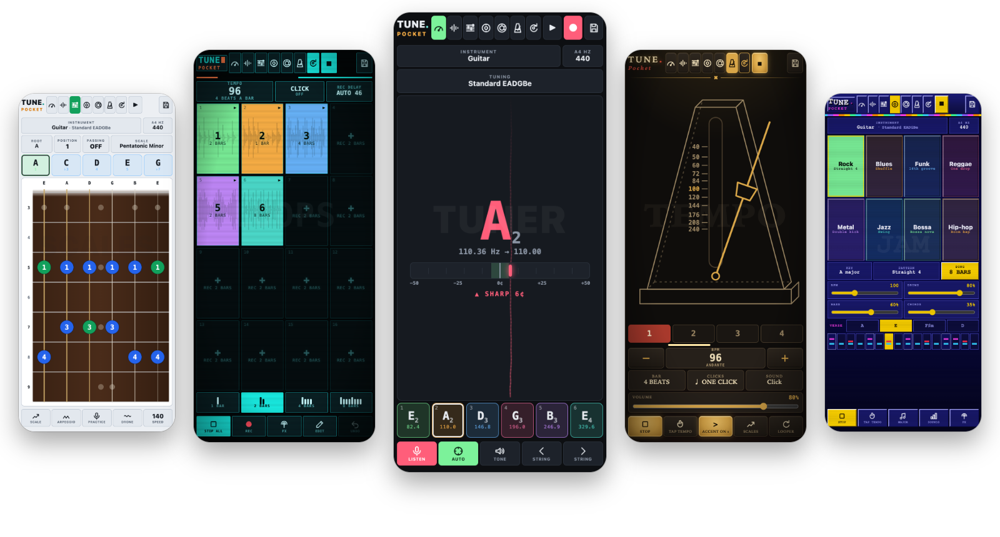
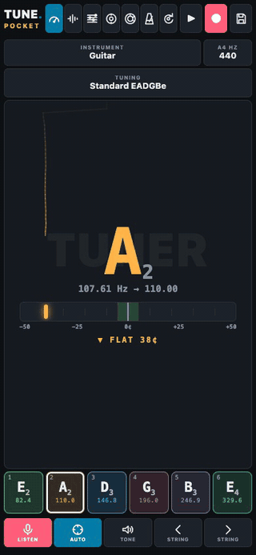
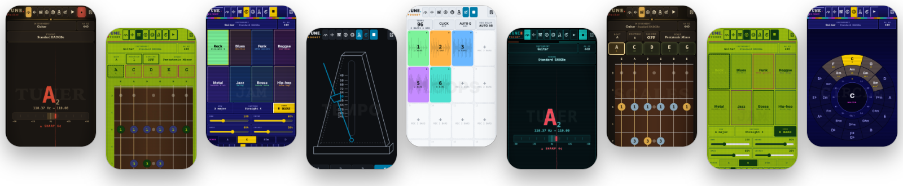
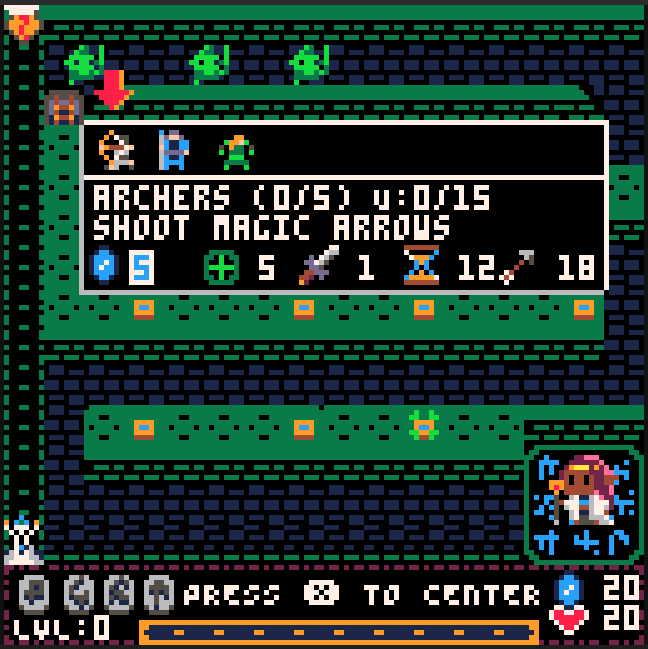
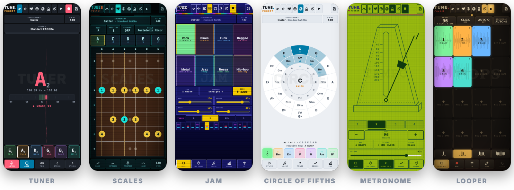
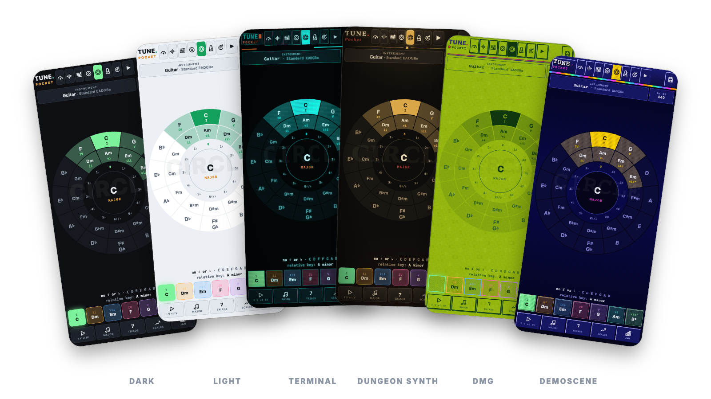

# TUNE.Pocket

Tune was the first app I actually coded with the help of AI for personal reasons. I found myself going through hurdles to find a good off-line guitalele tuner, and always ended up having to use an ad-ridden guitar tuner app and a lot of traditional fifth chord manual tuning. 

So I tried to make a Cordova baked monolithic HTML tuner... and I've been using it for a year. Self-hosted, because Cordova didn't work properly (mic issues).

Fast-forward to this weekend, I finished up retouching Track.Pocket (from the old Tune code and some of my Family Forge tracker code) and as an afterthought ended up in an hyperfocused refactor.

Thus came TUNE.Pocket, a pocket tuner, note detector, scale finder and jam band for guitar, bass, violin, guitalele and ukulele, the sister app of [TRACK.Pocket](https://github.com/utopick/track-pocket) and [SING.Pocket](https://github.com/utopick/sing-pocket). It runs from one self-contained HTML file, with no install, no dependencies and no network requests.

It should run fully offline, although opening the HTML file directly can cause microphone permission issues, so use the hosted GitHub page instead or self-host the HTML.

**Open it:** [utopick.github.io/tune-pocket](https://utopick.github.io/tune-pocket/) · **Install it:** it is a web app (PWA): on Android, Chrome ▸ **Install app**; on iPhone, Safari ▸ Share ▸ **Add to Home Screen**; on a computer, the install icon in the address bar. Once installed it opens like an app and works offline.

I've been adding features and tweaking a lot, so they come out not fully tested, and there could be bugs. Leave me an issue and I'll fix it.

There is a help wiki inside (también en español), with small interactive demos you can touch and hear: the tuner, the metronome, the looper's quantize and the circle of fifths.

I want to apologize to my neighbours for my live session afternoons and state here that I actually made a cow move gracefully out of the way with a tin whistle song. I have witnesses.

## Why did I release these apps? 

Because GitHub allows me to host them in a GitHub site if I make them public, and I don't want to host them myself. 

Also because my friends told me that they are useful and some of you may want a free, ad-less gadget to pass the time.

## Ads and cookies

Yeah, no.

No ads, no cookies, no nothing. This is free and clean. No hidden stealers, no weird intentions.

Why is it free? Because not everything should be a product.

## AI use

I'm a programmer and I have been coding for a living for over two decades, but life has given me too little free time that I want to spend offline and outside, making music and art. So I used a lot of AI to build this in a quick and easy way.

I'm not going to take credit for the code, even though I started this app from my own older code. I built it with the help of an AI coding assistant (Claude, by Anthropic), which wrote and reworked much of the code following my designs and notes.

The app itself uses no AI: everything runs on your device, and nothing you play, sing or record is sent to any AI service or anywhere else for that matter. If that isn't the case just shame me publicly and I'll fix it.

I did waste a lot of tokens by making it code it in a non-minified way, so if the bubble bursts and we go back to the basics it could be maintainable. 

If you want to try something made by me by hand (95%, I did use an early model to find some bugs but solved them by hand) in which I made the code, assets, music and all, check out Nanaya, my Pico-8 tower defense game: https://www.lexaloffle.com/bbs/?tid=153336

## How to run it

Open `index.html` in a modern web browser and tap **●** to listen. Your browser may ask for permission to play audio, so interact with the page first if you hear nothing.

The microphone needs `https://` or `localhost`, which is why the hosted page (or the installed app) is the easy way.

## The basics

- **Tuner:** pick the instrument and tuning, tap **●** and play a string. The nearest string pad lights up, and the meter and trace show how far off you are. Tap a pad to lock onto that string; **AUTO** follows the nearest one again. **TONE** plays the reference.
- **Detect:** shows any note you play or sing, with its frequency and cents, and draws it over time.
- **Scales:** 15 scales in any key, with a fretboard that follows the tuner's instrument and tuning. Play the scale, an arpeggio, or a root drone to practise over.
- **Jam:** a drum, bass and chord band in 8 styles, in any key, major or minor, with tap tempo and a mixer.
- **Circle of fifths:** every key with its relative minor and signature; the key's chords light up and play, with a I–V–vi–IV progression, triads or sevenths, and links to Scales and Jam.
- **Metronome:** a wireframe metronome you set by dragging its weight, with a swinging pendulum and numbered beats below. Pick 1–12 beats a bar, eighths, triplets or sixteenths, and four click sounds, or tap the tempo. It keeps ticking in the other views, so you can practise scales in time.
- **Looper:** 16 pads. Tap an empty one and it counts in a bar, then records a loop of 1, 2, 4 or 8 bars from the microphone. Tap a loop to start or stop it; all loops stay locked to the same bars. There are FX pads (the band's effects plus repeat, reverse and octave), overdub, reverse, normalize, crop to whole beats, quantize to a grid (by hand, or automatically as each loop lands with AUTO Q, off by default), nudge, clear and undo. Loops last until you close the app. Use headphones.
- **Setup:** custom tunings (notes like `E2`, `F#3`, `Bb1`, or frequencies in Hz), theme, options and help.

The A4 reference (415–466 Hz) is at the end of the instrument bar.

### Themes

Six looks, from **THEME** in Setup: Dark, Light, Terminal, Dungeon synth, DMG and Demoscene. All three Pocket apps share them.

They were surprinsingly designed by Claude from some sketches, so go figure. 

### Your settings

Settings and custom tunings are stored in your browser (`localStorage`). The looper's loops are kept in the browser's IndexedDB, saved by themselves and by name in TUNINGS ▸ FILES, where they can also be exported and imported as files. Nothing is uploaded anywhere. Tunings saved by the old LFTuner load automatically. Clearing browser storage removes everything, so export the loop sessions you want to keep.

## Install it as an app (PWA)

TUNE.Pocket is a progressive web app (PWA): the hosted page can be installed on the home screen or desktop, opens in its own window without browser bars, and keeps working with no connection. There is no store and no download. The first visit has to be online; after that it starts offline.

### iPhone and iPad (iOS)

1. Open [utopick.github.io/tune-pocket](https://utopick.github.io/tune-pocket/) in **Safari** (other iOS browsers cannot install web apps from the share menu).
2. Tap **Share**, then **Add to Home Screen**, then **Add**.
3. Open it from the new icon. The microphone asks for permission the first time you use it.

Notes: Safari on iOS has no Web MIDI, so MIDI keyboards and pads do not work there. On iOS, Safari deletes the data of websites you have not used for 7 days, but an app added to the Home Screen is exempt from that rule: so install it, rather than keeping it in a Safari tab. Even so, export what you want to keep (iOS can still free storage when the phone is nearly full).

### Android

1. Open the page in **Chrome** (Edge, Brave and Samsung Internet work too).
2. Choose menu ⋮ ▸ **Install app** (or **Add to Home Screen**), or accept the install banner if it shows.
3. Open it from the icon. Allow the microphone when asked; if you refused it, tap the lock icon in the address bar of a normal tab (or **Settings ▸ Apps ▸ TUNE.Pocket ▸ Permissions**).

MIDI keyboards and pads over USB or Bluetooth work in Chrome (Web MIDI).

### Desktop (Windows, macOS, Linux, ChromeOS)

1. Open the page in **Chrome** or **Edge** and click the install icon at the right end of the address bar (or menu ▸ **Install TUNE.Pocket**).
2. It opens in its own window and can be pinned to the taskbar or dock.
3. Firefox and Safari on desktop can use the page in a tab, but do not install it; Firefox also has Web MIDI, Safari does not.

### Good to know

- **Updates:** whenever it is online the app fetches the newest version; close and reopen it to run it.
- **Your data** lives in the browser's storage for this site (the installed app and a tab of the same browser share it). Export songs and recordings you want to keep before clearing browser data or switching device.
- **The Android APK is retired.** It was a Capacitor wrapper of this same page; the PWA does the same job without a build. The code stays in the [`android-legacy`](https://github.com/utopick/tune-pocket/tree/android-legacy) branch and the old APKs in [Releases](https://github.com/utopick/tune-pocket/releases); neither gets updates.

### Why is there a service worker (`sw.js`)?

Browsers only allow an app to work offline, and only offer to install it, if the site registers a **service worker**: a small script that sits between the page and the network. This one does a single job: on the first visit it saves the app's own files (`index.html`, the manifest and the icons) in the browser's cache, and afterwards it answers from that cache when you are offline. It asks the network first, so when you are online you always get the latest version. It cannot be part of `index.html`, because browsers load it as a separate file, and it never touches your songs, recordings, microphone or MIDI, and sends nothing anywhere.

## Files

- `index.html` — the complete app (markup, styles, audio code and the MIDI panel)
- `manifest.webmanifest`, `sw.js`, `icons/` — what makes it installable and offline (see above)
- `docs/` — notes for whoever maintains it; `tests/` — automated checks (`tests/e2e.py`, Selenium) and a test for the MIDI helpers
- `LICENSE` — license terms

## License

TUNE.Pocket is released under the MIT License (see `LICENSE`).

AI assisted coding uses the uncredited work of a lot of coders through the years (me included) so anything I make that's not for work its as free as possible.

Have fun.

### Third-party code

The banner, app icons and favicons are lettered in [Inter](https://rsms.me/inter/) (SIL Open Font License 1.1), converted to shapes, so no font file is included. The app itself has no third-party code.

## The readmes

Yeah. They are all similar. I copied and pasted. No one ever reads them all. Kilroy was here.

Anyway, listen to me: You matter. A lot. I don't know you stranger, but you have my admiration and love. Keep making art.